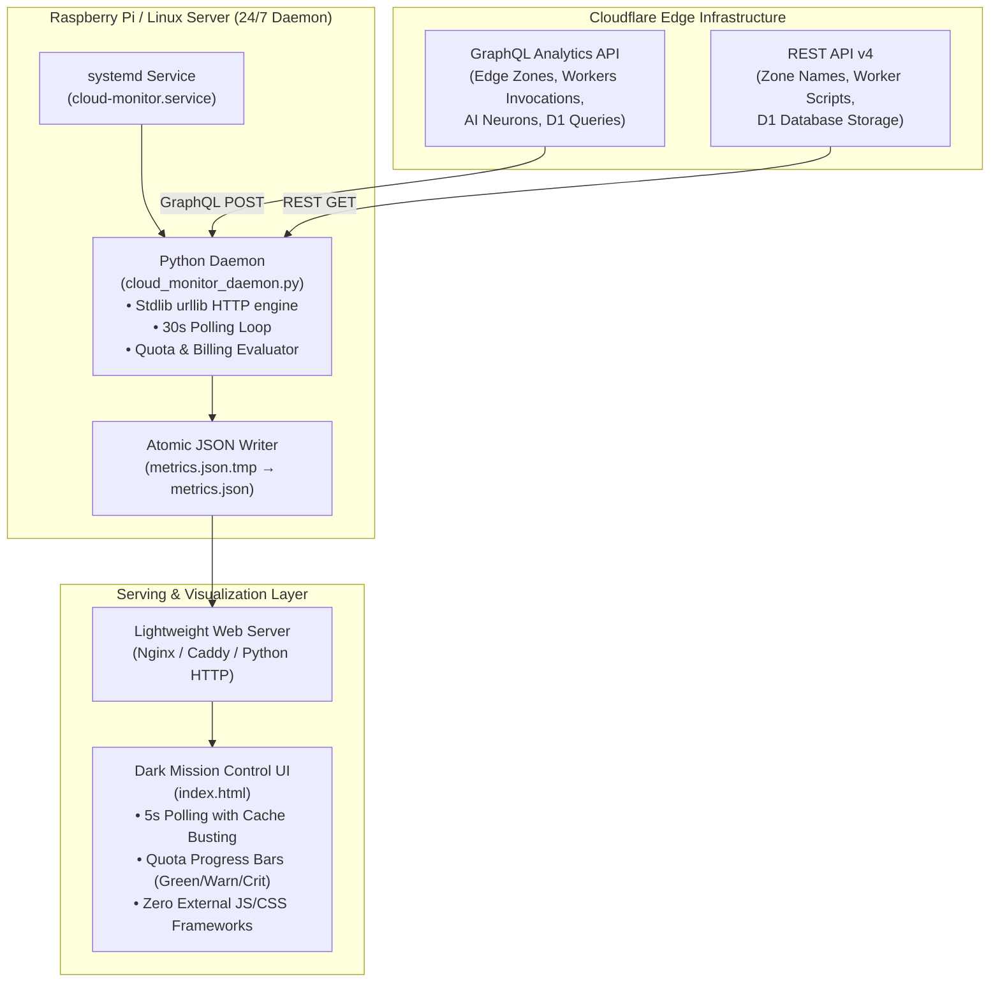

# 🍓 Raspberry Pi Cloudflare Network Operations Monitor

[](https://www.python.org/)
[](https://developers.cloudflare.com/)
[](https://freedesktop.org/wiki/Software/systemd/)
[-success.svg?style=flat)](#architecture)
[](LICENSE)

A lightweight, 24/7 telemetry daemon and real-time mission-control dashboard engineered for Raspberry Pi and single-board computers (SBCs). It polls Cloudflare GraphQL and REST APIs to provide edge performance analytics, quota tracking, and billable usage monitoring across multiple zones, Workers, Workers AI, and D1 databases.

---

## 📌 Architecture & Data Flow



---

## 🚀 Key Features

- **Multi-Zone Edge Telemetry**: Monitors edge response health, 1-hour traffic request volume, edge bandwidth ingestion (GB), edge cache hit ratio (%), blocked threat/security events, and 5xx origin error gateway spikes across multiple domain zones.
- **Workers & Pages Compute Tracking**: Tracks daily invocation quotas against Cloudflare's free-tier limits (100,000 req/day), month-to-date (MTD) worker requests, subrequests, execution errors, total CPU time (ms), Pages Functions, static assets served, and build minutes (against 3,000 min/mo).
- **Workers AI & Tokenomics Analytics**: Monitors daily Neuron consumption against free quota (10,000 Neurons/day), calculates estimated billable overages (\$0.011 / 1k Neurons), tracks total input/output tokens processed, aggregate inference compute duration, and model-level consumption (e.g., Llama 3, BGE Embeddings).
- **D1 Serverless SQL Analytics**: Monitors daily rows read (against 5M rows/day limit), daily rows written (against 100k rows/day limit), database cluster disk allocations (against 500 MB per-DB and 5 GB account limit), and per-database read/write SQL queries.
- **Zero External Dependencies**: Engineered strictly with standard library Python (`urllib.request`, `json`, `datetime`, `re`, `os`, `sys`). No `pip install`, virtual environment, or external wheel compilation required.
- **Atomic State Flushing**: State updates are written atomically (`metrics.json.tmp` replaced to `metrics.json`) to eliminate race conditions and partial JSON reads by frontend HTTP clients.
- **Self-Healing systemd Daemon**: Includes a hardened systemd unit file with automatic failure recovery (`Restart=always`, `RestartSec=10`).
- **Pure Native Web UI**: Vanilla HTML5, CSS Grid, and JavaScript. Zero external CDNs, tracking scripts, or bulky client frameworks. Low footprint ideal for Raspberry Pi Zero 2 W, 3, 4, or 5.

---

## 📊 Dashboard Preview

The operations room dashboard (`index.html`) is structured into four real-time monitoring sections:

```text
┌─────────────────────────────────────────────────────────────────────────────┐
│ 🌐 EDGE NETWORK OPERATIONS                  System Sync: 2026-10-30 01:00   │
│ Main Monitor: [ ONLINE ]                    Billing Cycle: 2026-10-01 → UTC │
├─────────────────────────────────────────────────────────────────────────────┤
│ 🔹 ZONE: example.com [Edge Zone (Past 1h)]                                  │
│  [Routing: HEALTHY] [Hit Vol: 32,840] [Bandwidth: 1.42 GB]                  │
│  [Cache Hit: 88.4%] [Threats: 0]      [Origin 5xx: 0]                       │
├─────────────────────────────────────────────────────────────────────────────┤
│ ⚡ WORKERS & PAGES BILLING USAGE                                             │
│  Daily Requests: [=========>      ] 42.1% of 100,000/day free                │
│  MTD Invocations: 184,200 | Build Mins: 14.2 min | CPU Time: 3,420 ms        │
├─────────────────────────────────────────────────────────────────────────────┤
│ 🧠 WORKERS AI BILLING & NEURON USAGE                                        │
│  Daily Neurons:  [====>           ] 28.5% of 10,000 free/day                │
│  MTD Neurons: 124,500 | In Tokens: 42,100 | Out Tokens: 18,900              │
├─────────────────────────────────────────────────────────────────────────────┤
│ 🗄️ D1 SERVERLESS SQL BILLING & QUOTAS                                       │
│  Daily Rows Read:    [=>          ] 6.2% of 5,000,000/day free              │
│  Daily Rows Written: [===>        ] 18.0% of 100,000/day free               │
│  Total D1 Storage: 24.5 MB (0.49% of 5 GB limit)                            │
└─────────────────────────────────────────────────────────────────────────────┘
```

Visual health statuses automatically adapt based on consumption thresholds:
- 🟢 **Healthy (< 60%)**: Safe consumption within free tier limits.
- 🟡 **Warning (60% – 79%)**: Approaching daily/monthly quotas.
- 🔴 **Critical (≥ 80%)**: Immediate attention required; risk of throttling or overage charges.

---

## 🛠️ Hardware & Software Requirements

- **Supported Hardware**:
  - Raspberry Pi (Zero 2 W, 3B, 3B+, 4B, 5, Compute Module 4/5)
  - Any standard Linux SBC (Orange Pi, Rock Pi, Libre Computer)
  - Any Debian / Ubuntu / Fedora / Alpine server, VPS, or Docker container
- **Python Runtime**: Python 3.8 or higher (standard library only)
- **Web Server**: Any static web server (Nginx, Lighttpd, Caddy, or Python's `http.server`)

---

## 🔑 Cloudflare API Token Setup

1. Log in to the [Cloudflare Dashboard](https://dash.cloudflare.com/) and navigate to **My Profile > API Tokens > Create Token**.
2. Select **Create Custom Token** and configure the following permissions:

| Context | Permission | Access Level | Description |
| :--- | :--- | :--- | :--- |
| **Account** | *Workers AI* | **Read** | Reads model telemetry, Neurons, and tokens |
| **Account** | *Workers Scripts* | **Read** | Enumerates deployed Workers and Pages projects |
| **Account** | *Pages* | **Read** | Reads Pages builds and functions metadata |
| **Account** | *D1* | **Read** | Reads database sizes and cluster inventories |
| **Account** | *Account Analytics* | **Read** | Queries GraphQL analytics for account metrics |
| **Zone** | *Zone* | **Read** | Resolves Zone IDs to human-readable domain names |
| **Zone** | *Analytics* | **Read** | Queries 1h GraphQL edge traffic, cache, and 5xx stats |

3. Under **Account Resources** and **Zone Resources**, select **All accounts** and **All zones** (or scope to specific target zones).
4. Save the generated token securely.

---

## 📦 Installation & Setup

### 1. Clone the Repository

```bash
git clone https://github.com/your-username/raspberry-pi-cloudflare-network-operations-monitor.git
cd raspberry-pi-cloudflare-network-operations-monitor
```

### 2. Configure Environment Variables

Edit `cloud-monitor.service` or export the variables in your shell environment:

```ini
Environment="CLOUDFLARE_API_TOKEN=your_cloudflare_api_token_here"
Environment="CLOUDFLARE_ACCOUNT_ID=your_cloudflare_account_id_here"
Environment="CF_ZONE_ID_1=your_first_zone_id_here"
Environment="CF_ZONE_ID_2=your_second_zone_id_here"

# Telegram Bot Context (Optional)
Environment="TELEGRAM_BOT_TOKEN=your_telegram_bot_token_here"
Environment="TELEGRAM_CHAT_ID=your_telegram_chat_id_here"
```

> [!TIP]
> To find your **Account ID** and **Zone IDs**:
> - Open any domain in the Cloudflare dashboard.
> - Look at the bottom-right sidebar on the **Overview** page for **Account ID** and **Zone ID**.

### 3. Verify Polling with a Test Run

Run the daemon in one-off execution mode to verify API authentication and output generation:

```bash
python3 cloud_monitor_daemon.py --once
```

Check that `metrics.json` was generated successfully:

```bash
cat metrics.json
```

### 4. Deploy the systemd Daemon

Install the daemon script and service to run automatically on boot:

```bash
# Copy files into standard system locations
sudo cp cloud_monitor_daemon.py /usr/local/bin/cloud_monitor_daemon.py
sudo chmod +x /usr/local/bin/cloud_monitor_daemon.py
sudo cp cloud-monitor.service /etc/systemd/system/cloud-monitor.service

# Reload systemd and enable the service
sudo systemctl daemon-reload
sudo systemctl enable cloud-monitor.service
sudo systemctl start cloud-monitor.service

# Check service status
sudo systemctl status cloud-monitor.service
```

To follow live daemon logs:

```bash
sudo journalctl -u cloud-monitor.service -f
```

---

## 🌐 Serving the Dashboard

The dashboard consists of [`index.html`](file:///C:/Users/simon/Public/raspberry-pi-cloudflare-network-operations-monitor/index.html) reading [`metrics.json`](file:///C:/Users/simon/Public/raspberry-pi-cloudflare-network-operations-monitor/metrics.json) from the same web directory.

### Option A: Nginx (Recommended for Production)

Install Nginx and deploy the dashboard:

```bash
sudo apt update && sudo apt install -y nginx

# Create web directory and deploy files
sudo mkdir -p /var/www/html/dashboard
sudo cp index.html /var/www/html/dashboard/index.html

# Set appropriate permissions
sudo chown -R www-data:www-data /var/www/html/dashboard
```

The daemon automatically detects `/var/www/html` on Linux and continuously updates `/var/www/html/metrics.json`.

Access your dashboard in any browser at:
```text
http://<your-raspberry-pi-ip>/dashboard/
```

### Option B: Quick Local Server (Testing / Ad-hoc)

You can serve the folder immediately using Python's built-in HTTP server:

```bash
python3 -m http.server 8080
```

Then navigate to `http://localhost:8080/index.html`.

---

## ⚙️ Configuration Reference

| Environment Variable | Description | Default / Example |
| :--- | :--- | :--- |
| `CLOUDFLARE_API_TOKEN` | Scoped Cloudflare API Token | `None` (Required) |
| `CLOUDFLARE_ACCOUNT_ID` | 32-character Cloudflare Account Tag | `None` (Required) |
| `CF_ZONE_ID_1` | Zone ID for the primary monitored domain | `None` (Required) |
| `CF_ZONE_ID_2` | Zone ID for a secondary monitored domain | `None` (Optional) |
| `METRICS_OUTPUT_PATH` | Path where `metrics.json` is saved | `/var/www/html/dashboard/metrics.json` |
| `TELEGRAM_BOT_TOKEN` | Bot token for Telegram alert integration | `Optional` |
| `TELEGRAM_CHAT_ID` | Target Telegram Chat ID for alerts | `Optional` |

---

## 📈 Quota Constants & Pricing Logic

The daemon monitors usage against standard Cloudflare Free Tier thresholds:

| Service Metric | Free Tier Quota Threshold | Overage Unit Pricing |
| :--- | :--- | :--- |
| **Workers Daily Requests** | 100,000 requests / day (UTC) | Paid plan requirement |
| **Pages / Workers Build Minutes** | 3,000 minutes / month | Standard build limits |
| **Workers AI Daily Neurons** | 10,000 Neurons / day (UTC) | \$0.011 per 1,000 Neurons |
| **D1 Daily Rows Read** | 5,000,000 rows / day (UTC) | \$0.001 per 1M rows |
| **D1 Daily Rows Written** | 100,000 rows / day (UTC) | \$1.00 per 1M rows |
| **D1 Database Storage** | 500 MB / database (5 GB account) | \$0.75 per GB-month |

---

## 🔒 Security & Privacy

- **Read-Only API Tokens**: The daemon requires read-only permissions and makes zero state-altering or write requests to your Cloudflare infrastructure.
- **Local Network Boundary**: The dashboard runs strictly on your private local network (LAN) and transmits zero metrics or tracking data to third parties.
- **Credential Safety**: The fallback loader safely parses standard systemd service files or OS environment variables; never commit real tokens or credentials into version control.

---

## 📄 License

This project is licensed under the [MIT License](LICENSE).
